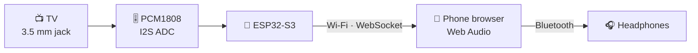
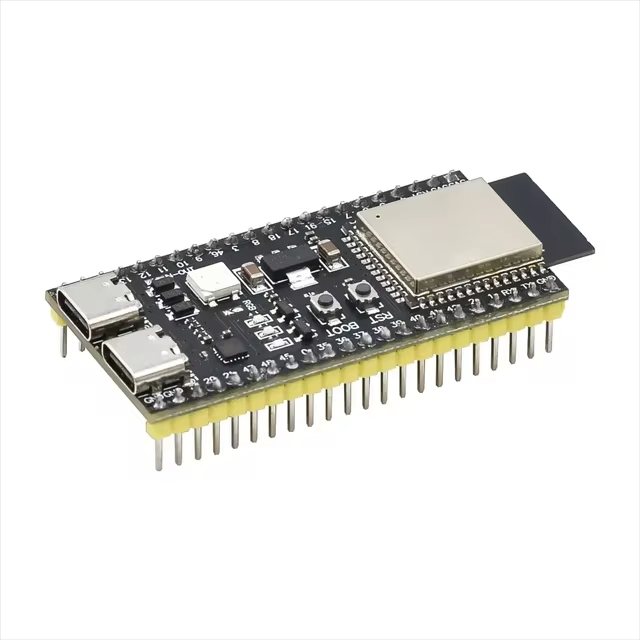
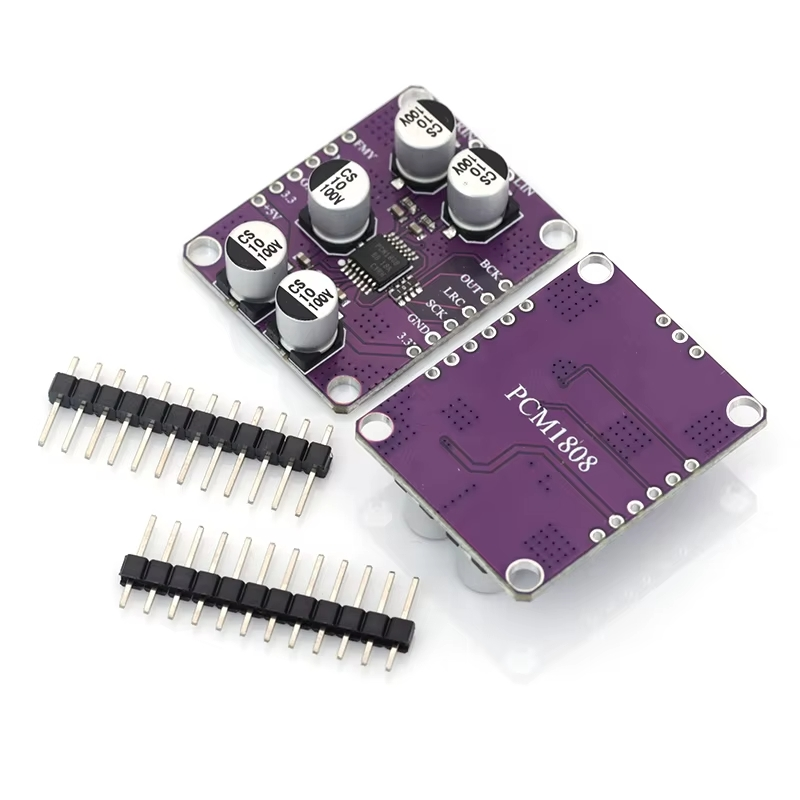

<div align="center">

# 📡 WIFI-TV-Emitter

**Listen to your old TV on Bluetooth headphones, through your phone's browser**

ESP32-S3 &nbsp;•&nbsp; PCM1808 &nbsp;•&nbsp; Wi-Fi &nbsp;•&nbsp; Web Audio

[](https://platformio.org/)
[](https://www.espressif.com/en/products/socs/esp32-s3)
[](https://github.com/espressif/arduino-esp32)
[](https://developer.mozilla.org/en-US/docs/Web/API/Web_Audio_API)
[](LICENSE)

🇬🇧 **English** &nbsp;·&nbsp; [🇷🇺 Русский](README.ru.md)


</div>

---

<!-- Add a screenshot of the web page and uncomment:
<p align="center"></p>
-->

## 📖 Table of contents

- [✨ Features](#-features)
- [🧩 How it works](#-how-it-works)
- [🔌 Hardware and wiring](#-hardware-and-wiring)
- [🚀 Setup](#-setup)
- [🎧 Usage](#-usage)
- [🔧 Configuration](#-configuration)
- [🚧 Limitations](#-limitations)
- [🧰 Troubleshooting](#-troubleshooting)
- [🔗 Links and credits](#-links-and-credits)
- [📄 License](#-license)

## ✨ Features

- 🎙️ Mono stream, 16-bit, 32 kHz (about 64 KB/s)
- 📱 Nothing to install on the phone: the ESP serves its own web page
- 🎚️ Two sliders, applied live:
  - **Buffer (latency):** 0.1–1.0 s. Lower means less delay but possible clicks.
  - **Noise gate threshold:** 0–1500 (0 = off). Sends silence when the input is below the threshold, which hides hiss and crackle in pauses.
- 🔧 DC-offset removal filter
- 📶 Joins your home Wi-Fi automatically, with a fallback access point if the router is not found
- 🌐 Reachable at `http://tvaudio.local` (mDNS)

## 🧩 How it works



The ESP32-S3 digitizes the analog signal through the PCM1808 over I2S and pushes it to the browser over a WebSocket. The page plays it with the Web Audio API.


> **Why not connect to the headphones directly?** Bluetooth headphones use Classic Bluetooth (A2DP). The ESP32-S3 only has Bluetooth LE, so it cannot stream audio to them, and the phone acts as the bridge. A classic ESP32 (WROOM/WROVER) can do A2DP directly with a library such as [ESP32-A2DP](https://github.com/pschatzmann/ESP32-A2DP), but that is not what this project does.

## 🔌 Hardware and wiring

**You need:**

- 🧠 ESP32-S3 dev board (tested on an ESP32-S3-DevKitC-1 style board)
- 🎚️ [PCM1808](https://aliexpress.ru/item/1005012718811058.html?shpMethod=CAINIAO_SUPER_ECONOMY&sku_id=12000059136057404&spm=a2g2w.productlist.search_results.0.6d114a68umo8Sn) I2S ADC module
- 🔊 3.5 mm cable or jack for the TV headphone output
<table align="center">
  <tr>
    <td align="center"><br><b>ESP32-S3</b></td>
    <td align="center"><br><b>PCM1808</b></td>
  </tr>
</table>

Pin names differ between PCM1808 modules, so check the silkscreen on yours.

| | PCM1808 | ESP32-S3 / other |
|---|---|---|
| ⚡ Power | +5V (check that your board actually outputs 5V on this pin and does not only accept it; the photo below shows where to take 5V from) | 5V |
| ⚡ Power | 3.3 | 3V3 |
| ⚡ Power | GND | GND |
| 🧷 Mode | MD0, MD1, FMT | GND (slave mode, I2S format) |
| 🕐 I2S | SCK (MCLK) | GPIO 7 |
| 🕐 I2S | BCK | GPIO 4 |
| 🕐 I2S | LRC (LRCK) | GPIO 5 |
| 🕐 I2S | OUT (DOUT) | GPIO 6 |
| 🔊 Input | LIN | jack tip (left) |
| 🔊 Input | RIN | jack ring (right) |
| 🔊 Input | AGND / ground symbol | jack sleeve |


The pins are set at the top of `src/main.cpp`. Avoid GPIO 26–37 on boards that use those pins for PSRAM or flash.

## 🚀 Setup

1. Install [PlatformIO](https://platformio.org/).
2. Clone the repository:
   ```bash
   git clone https://github.com/Artin-cell/WIFI-TV-Emitter.git
   cd WIFI-TV-Emitter
   ```
3. Copy `src/secret_example.h` to `src/secret.h` and enter your Wi-Fi credentials:
   ```cpp
   #define STA_SSID_VALUE "your_network"
   #define STA_PASS_VALUE "your_password"
   ```
   > [!TIP]
   > `secret.h` is listed in `.gitignore`, so your password is never committed.
4. Build and upload:
   ```bash
   pio run -t upload
   ```
5. Connect the PCM1808 to the TV jack (start with a low TV volume).

## 🎧 Usage

1. Connect your phone to the same Wi-Fi network.
2. Open `http://tvaudio.local` in a browser. On Android this name may not resolve; then use the board's IP address from your router's client list.
3. Tap **Listen**, and put on your Bluetooth headphones.

If the router is not found within 15 seconds, the board creates its own network `TV-Audio` (password `12345678`). Open `http://192.168.4.1`.

## 🔧 Configuration

Constants at the top of `src/main.cpp`:

| Constant | Meaning |
|---|---|
| `SAMPLE_RATE` | Sample rate. Must match `RATE` in the web page script. |
| `FRAMES` | Frames per packet (2048 ≈ 64 ms). Larger means fewer packets, easier for slow phones, slightly more latency. |
| `SHIFT` | 16 = as is; 15 or 14 = 2× or 4× louder (with clipping protection). |
| `GATE_DEFAULT` | Initial noise gate threshold. |
| `GATE_HOLD_BLOCKS` | How long the gate stays open after the last loud packet. |
| `AP_SSID`, `AP_PASS` | Fallback access point. |

## 🚧 Limitations

- ⏱️ **Latency** is roughly 0.3–0.5 s plus the Bluetooth delay on the phone. Fine for news and podcasts, but lip-sync will be off for movies.
- 📵 Keep the phone screen on. Some browsers stop audio in the background or when the screen locks.
- 🔊 Headphone outputs can be too loud for the PCM1808 input. If the sound is distorted, lower the TV volume.

## 🧰 Troubleshooting

<details>
<summary>🔇 No sound, level is always zero</summary>

Check that MD0, MD1 and FMT are tied to GND, that the module is powered (5 V and 3.3 V), and that SCK, BCK, LRC and OUT are on the right GPIOs. Keep the SCK wire short.

</details>

<details>
<summary>🔥 Crackling when idle</summary>

Test with LIN and RIN shorted to GND. If the noise disappears, it is picked up by the input wiring or comes from the TV or a ground loop. Try powering the board from a power bank, shorten and twist the input wires, and add decoupling capacitors (100 µF + 100 nF) near the module. The noise gate slider hides what remains.

</details>

<details>
<summary>🐌 Stutters on a weak phone</summary>

Raise the buffer slider, keep the screen on, and disable battery saving for the browser.

</details>

<details>
<summary>🌐 Page does not open on Android</summary>

Use the IP address instead of `tvaudio.local`, or turn off mobile data.

</details>

## 🔗 Links and credits

- [PlatformIO](https://platformio.org/)
- [arduino-esp32](https://github.com/espressif/arduino-esp32)
- [arduinoWebSockets](https://github.com/Links2004/arduinoWebSockets) by Links2004
- [Web Audio API (MDN)](https://developer.mozilla.org/en-US/docs/Web/API/Web_Audio_API)
- [PCM1808 (Texas Instruments)](https://www.ti.com/product/PCM1808)

## 📄 License

Released under the [MIT License](LICENSE).